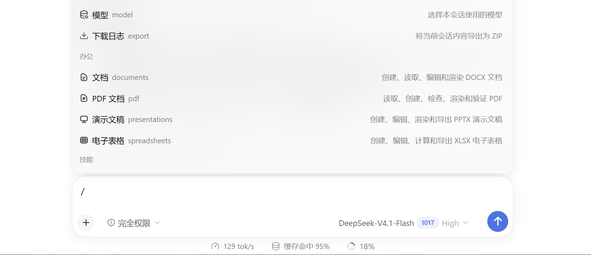

# dsh-office-suite

[![CI][ci-src]][ci-href]
[![DSH][dsh-src]][dsh-href]
[![License][license-src]][license-href]

为 DeepSeek Harness (DSH) 提供本地 Office 文档能力：Word、PDF、演示文稿与电子表格，通过 `/` 菜单和引用 Chip 驱动。

* **系统要求**：DSH $\ge$ `0.2.1-rc.2`；Node.js $\ge$ `20`；Python `3.10`–`3.13`。

---

## 能力

| 命令 | 格式 | 创建/读取/编辑 | 渲染 | 其他 |
| --- | --- | --- | --- | --- |
| `/documents` | DOCX | 支持 | Word、LibreOffice | 表格、图片、公式、页眉页脚 |
| `/pdf` | PDF | 支持 | PyMuPDF | 合并、旋转、删页、元数据 |
| `/presentations` | PPTX | 支持 | PowerPoint、LibreOffice | 文本、项目符号、表格、图表、图片 |
| `/spreadsheets` | XLSX | 支持 | Excel、LibreOffice | 公式、样式、图表、冻结窗格、重算 |



## 安装

```bash
dsh plugin add dsh-office-suite
```

安装后在 **设置 → 插件** 中启用。`postinstall` 会检测 Python：

* Windows 上没有兼容 Python 时，自动下载官方 Python 3.12.10，验证全部依赖导入。
* macOS / Linux 只验证现有 Python，不自动下载。

---

## 使用

1. 在输入框键入 `/`，选择 **文档**、**PDF 文档**、**演示文稿** 或 **电子表格**。
2. 回车插入 Chip，然后描述任务。
3. Agent 调用 `office_status`，加载对应技能，写 JSON spec，用绝对路径 Python 调用内置 CLI；有渲染器时渲染 PNG 并做视觉检查。

### 在预览中请求修改

打开 PDF、DOC 或 DOCX 后，点击预览工具栏的 **请求修改**。悬停吸附文字段落，点击填写要求；拖动可框选区域，松开后填写要求。按 Esc 先取消当前选区，再按一次退出标注模式。

底部 **注释数量** 可悬停查看暂存列表，**取消** 清空本批，**发送** 将标注加入当前会话。PDF 同时附上选区截图，DOC/DOCX 只发送文字与位置信息；已有会话草稿时先合入草稿，由用户确认发送。会话中的注释数量以链接显示，悬停或键盘聚焦可查看文件名与修改要求；原文、定位信息和 PDF 截图仍完整发送给模型。

PDF 截图依赖当前 DSH 的附件接入能力，不可用时明确禁用。段落吸附依据预览文字层的实际字块位置；扫描 PDF 仍可框选截图，但不提供 OCR。会话浮层使用浏览器原生 Popover 顶层显示；暂存标注可跨预览标签切换保留，但刷新页面后不保留。

---

## 配置

* 配置：  `%APPDATA%\dsh-office-suite\config.json`（Windows）、
          `~/Library/Application Support/dsh-office-suite/config.json`（macOS）、
          `$XDG_CONFIG_HOME/dsh-office-suite/config.json`（Linux）。
* `DSH_OFFICE_PYTHON` 可覆盖宿主与 `postinstall` 的解释器发现。
* 配置记录 `python`、`basePython`、`pythonVersion`、`pluginVersion`、`updatedAt` 与导入校验结果；损坏的配置会被跳过并回退到自动发现。

---

## 已知限制

不支持 Google Docs / Slides / Sheets 或任何远程编辑；不提供 OCR、PDF 表单填写/签名、DOCX 批注/修订/目录/水印、PPTX 动画/备注/模板、XLSX 数据透视表/宏/数据验证/条件格式。

完整能力追踪与未支持清单见 [CAPABILITY.md](CAPABILITY.md)。

---

## 开发

```bash
pnpm install
pnpm run lint --fix
pnpm run typecheck
pnpm run test -- --run
pnpm run build
```

集成测试在含中文和空格的临时目录中创建文件；缺少兼容 Python 时跳过 Python 用例，API 快照与功能注册测试仍会运行。检测到 Word 或 LibreOffice 时执行渲染测试。

---

* **本地验证**：2026-10-20，59 个用例通过；lint、类型检查、构建通过。
* **未验证项**：本次标注交互与浮层布局尚未在运行中的 GUI 手动验证；本次未运行远程 CI，npm 包尚未发布。

---

## 许可证

MIT

<!-- Badges -->

[ci-src]: https://github.com/hairyf/dsh-office-suite/actions/workflows/ci.yml/badge.svg
[ci-href]: https://github.com/hairyf/dsh-office-suite/actions/workflows/ci.yml
[dsh-src]: https://img.shields.io/badge/DSH-0.2.1--rc.2-080f12?style=flat&colorA=080f12&colorB=1fa669
[dsh-href]: https://github.com/deepseek-ai/deepseek-harness
[license-src]: https://img.shields.io/github/license/hairyf/dsh-office-suite.svg?style=flat&colorA=080f12&colorB=1fa669
[license-href]: https://github.com/hairyf/dsh-office-suite/blob/main/LICENSE.md
